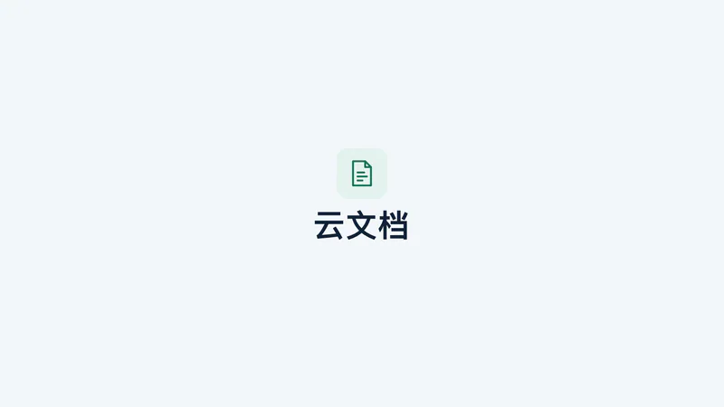
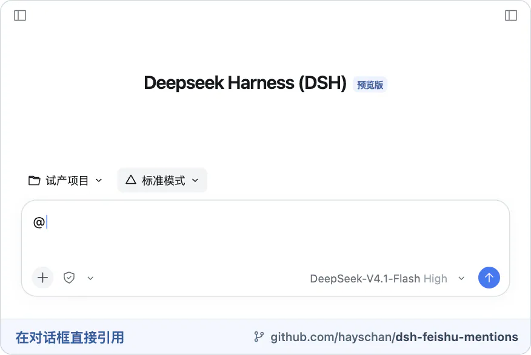
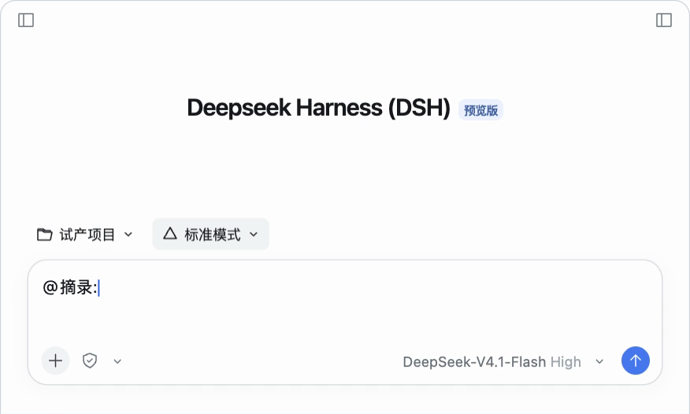

# 在 DeepSeek Harness 里，打个 `@` 就能引用飞书

在 DeepSeek Harness 的输入框打个 `@`，就能搜索并选中飞书里的文档、表格、群聊或同事。

以前，即使装了飞书 CLI（`lark-cli`），手动引用资料也常要花上一分钟。先切到飞书搜索，复制链接或会话 ID，再贴回 Harness。

[](docs/USAGE.md#演示)

## 找人：姓名、全拼和首字母都能搜

输入姓名 `@林澈`、全拼 `@linche` 或首字母 `@lc` 都能找到林澈。遇到重名时，看头像和部门。


## 找资料：只记得几个字，也能选对资料

输入 `@物料` 搜索云盘和知识库。几份资料标题相近时，可以按作者和修改时间选对「试产物料跟踪表」。



## 找群：在输入框里找到项目群

输入 `@协调`，按群名和头像选中「试产协调群」。


## 摘录：把纪要和群里的新进展放在一起

会上列过缺料清单，群里又更新了到货日期。用 `@摘录:评审` 选纪要、用 `@摘录:协调` 选群聊，发送时就会带上文档摘录和最近的群消息。

> 对照纪要和群里的最新消息，列出已经确认的到货日期，以及还要找谁跟进。



## 把三天的消息整理进交接文档

交接事项散在群里时，用 `@协调` 选消息来源，再用 `@交接` 选要写入的文档。

> 把 `@试产协调群` 最近 3 天的消息整理到 `@试产交接记录` 文末，分成「已确认」「待跟进」「待确认」，带上负责人和期限。


要整理私聊时，用 `@林澈` 选择联系人。 [交接读写设置](docs/USAGE.md#把聊天整理到交接文档)

## 安装

1. 安装飞书 CLI，用自己的飞书账号授权。 [飞书 CLI 安装与授权](https://github.com/larksuite/cli)
2. 在 Harness 打开 **插件 → 添加插件**，粘贴下面的地址，点击 **安装 → 立即启用**。

   ```text
   https://github.com/hayschan/dsh-feishu-mentions/releases/download/v0.4.1/dsh-feishu-mentions-0.4.1.tgz
   ```

3. 打开工作区，输入 `@` 试用。

[使用指南](docs/USAGE.md) · [开发与发布](docs/DEVELOPMENT.md) · [English quick start](docs/USAGE.md#english-quick-start) · [反馈问题](https://github.com/hayschan/dsh-feishu-mentions/issues) · [MIT 许可证](LICENSE)
