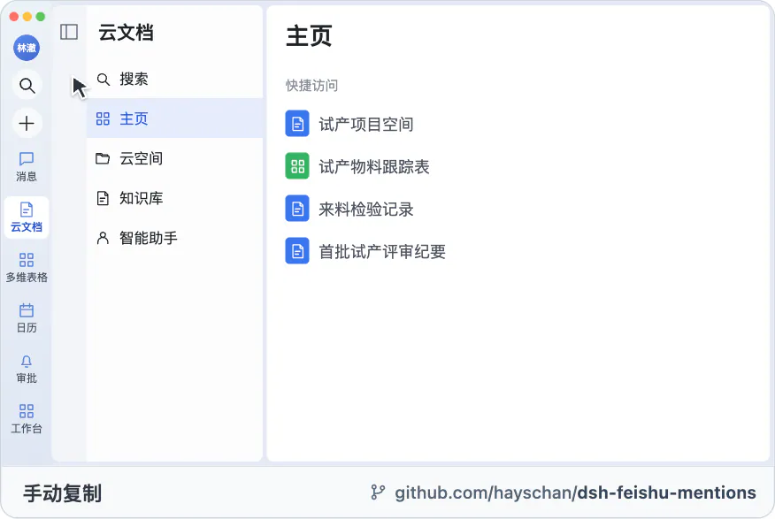
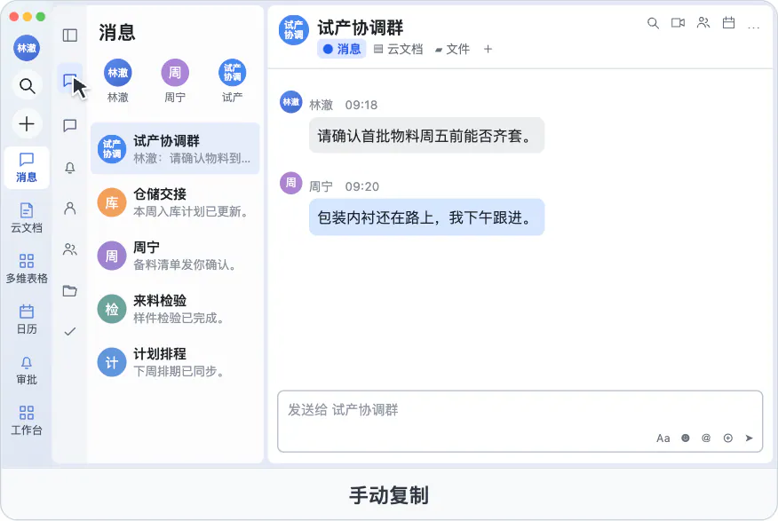
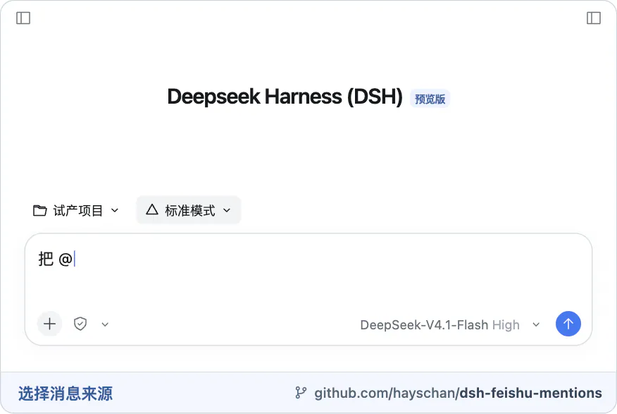
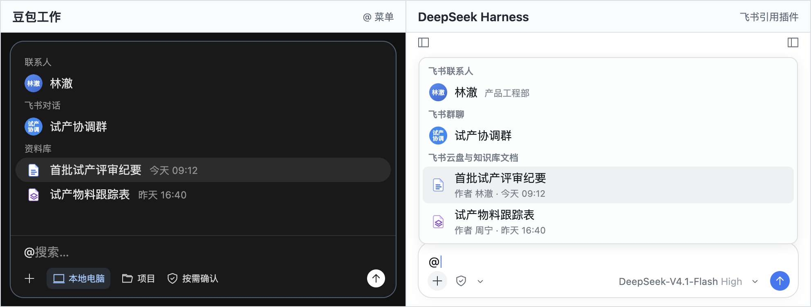

# DeepSeek Harness 飞书引用

https://github.com/user-attachments/assets/fa061ee7-3d42-4357-915c-d74068a7d0e5

周五要试产，你想确认还有哪些物料没到。在 DeepSeek Harness 输入 `@物料`，选中「试产物料跟踪表」，接着写「列出还没到齐的物料」。同一个输入框也能找群聊、同事、表格和知识空间。

[下载完整演示（35 秒 · 1080p MP4）](https://raw.githubusercontent.com/hayschan/dsh-feishu-mentions/main/docs/videos/feishu-mentions-demo.mp4) · [安装插件](#安装) · [查看发布版本](https://github.com/hayschan/dsh-feishu-mentions/releases)

## 引用文档，输入标题里的几个字

在飞书里，先搜到「试产物料跟踪表」，打开表格，点右上角的「分享」，再从分享面板底部复制链接。用插件时，在写问题的地方输入 `@物料`，看一眼作者和修改时间就能选中。点击任一动图可以单独放大查看。

<p align="center">
  <a href="docs/images/feishu-document-manual.webp"></a>&emsp;&ensp;
  <a href="docs/images/harness-document-direct.webp"></a>
</p>

## 引用群聊，认出群头像就能选

手动找会话 ID，要搜到「试产协调群」，打开右上角的「···」，把右侧设置滚到底，再点 ID 旁的复制图标。用插件时，输入 `@协调` 就能按头像和群名选择，接着问「哪些物料还没到齐？」。

<p align="center">
  <a href="docs/images/feishu-chat-manual.webp"></a>&emsp;&ensp;
  <a href="docs/images/harness-chat-direct.webp"></a>
</p>

## 引用同事，只记得拼音也能找

想问「林澈负责哪些试产物料？」在对话框里输入 `@林澈`、`@linche` 或 `@lc` 都可以。看一眼头像和姓名旁的「产品工程部」，选中林澈，接着写问题。首字母相同的同事可能有好几位，部门可以帮你选对人。

<p align="center">
  <a href="docs/images/harness-person-direct.webp"></a>
</p>

如果希望把评审纪要正文或最近的群消息也一起发给模型，选择 `@摘录:评审` 或 `@摘录:协调`。动图按飞书与 Harness 的界面和操作重绘，使用虚构的试产项目资料。[飞书的文档分享说明](https://www.feishu.cn/hc/zh-CN/articles/360049067526)

## 把最近三天的聊天整理进交接文档

交班前，到货进展散在飞书消息里，下一班要看的是《试产交接记录》。在 Harness 里用 `@` 选两次：先选消息来自哪个群或哪位同事，再选要写入的飞书云文档。

**从群聊整理**　输入 `@协调` 选中「试产协调群」，再用 `@交接` 选中「试产交接记录」。

> 把 @试产协调群 最近 3 天的消息汇总到 @试产交接记录 文末。分为「已确认」「待跟进」「待确认」，保留消息里提到的负责人和期限。

**从私聊整理**　输入 `@lc` 选中产品工程部的「林澈」，目标文档仍选「试产交接记录」。

> 把我和 @林澈 最近 3 天私聊里提到的物料进展追加到 @试产交接记录 文末。列出已到货物料、还要跟进的事项，以及林澈答应反馈的时间。

<p align="center">
  <a href="docs/images/recent-messages-to-doc.webp"></a>
</p>

这个案例使用普通 `@` 引用。Harness 需要能运行已登录的飞书 CLI，当前账号需能读取所选会话并编辑目标文档。插件传入会话和文档标识，Harness 按指定时间读取消息，再把摘要追加到文末。上图用虚构消息演示写入效果。

<details>
<summary>单独下载某个操作的视频（MP4）</summary>

| 场景 | 手动复制 | 在对话框直接引用 |
| --- | --- | --- |
| 引用云文档 | [下载飞书操作](https://raw.githubusercontent.com/hayschan/dsh-feishu-mentions/main/docs/videos/feishu-document-manual.mp4) | [下载 Harness 操作](https://raw.githubusercontent.com/hayschan/dsh-feishu-mentions/main/docs/videos/harness-document-direct.mp4) |
| 引用群聊 | [下载飞书操作](https://raw.githubusercontent.com/hayschan/dsh-feishu-mentions/main/docs/videos/feishu-chat-manual.mp4) | [下载 Harness 操作](https://raw.githubusercontent.com/hayschan/dsh-feishu-mentions/main/docs/videos/harness-chat-direct.mp4) |
| 引用同事 | — | [下载姓名、全拼和首字母演示](https://raw.githubusercontent.com/hayschan/dsh-feishu-mentions/main/docs/videos/harness-person-direct.mp4) |
| 把近期消息汇总到文档 | — | [下载群聊交接示例](https://raw.githubusercontent.com/hayschan/dsh-feishu-mentions/main/docs/videos/recent-messages-to-doc.mp4) |

</details>

## 安装

1. 准备 DeepSeek Harness（已在 `0.2.2-rc.5` 验证）和飞书官方 CLI（已在 `1.0.97` 验证）。按官方 CLI 说明配置应用，登录自己的飞书账号，运行 `lark-cli auth status` 核对用户身份。读取范围取决于应用权限和当前用户可以访问的资料。[飞书 CLI 安装与授权](https://github.com/larksuite/cli)
2. v0.5.0 首次发布到 npm 后，在桌面版打开 **插件 → 添加插件**，填入下面的 npm 包名，点击 **安装 → 立即启用**。首次 npm 发布前，可用 v0.4.1 的 .tgz 下载地址安装。各版本安装包见 [Releases](https://github.com/hayschan/dsh-feishu-mentions/releases)。

   ```text
   @hayschan/dsh-feishu-mentions
   ```

3. 打开一个工作区，输入 `@`。看到飞书联系人、群聊和云盘资料后，选中一项就可以开始提问。

**更新**　在「设置 → 通用 → 飞书引用」点「检查更新」。按 npm 包名安装的用户可以确认安装兼容的稳定新版，界面会报告是否需要重启。开发链接仅查询版本。旧版安装包用户请在插件管理器移除旧插件，再用上面的包名安装。两个版本使用相同的引用来源和引用数据格式。

<details>
<summary>菜单提示找不到飞书 CLI？</summary>

在终端运行 `lark-cli auth status`。如果终端能找到 CLI，请确认 Harness 进程的 PATH 包含 `lark-cli`，或在启动环境中把 `DSH_FEISHU_CLI` 设为该可执行文件的绝对路径。插件也会检查 macOS 的常用 Homebrew 安装位置。

</details>

## 在提示词中使用

| 输入 | 菜单内容 |
| --- | --- |
| `@` | 最近联系过的人、活跃群聊、近一个月打开的资料和可见知识空间 |
| `@试产` | 跨类别搜索，可用鼠标或方向键和回车选择 |
| `@林澈`、`@linche`、`@lc` | 用中文姓名、全拼或拼音首字母查找同事 |
| `@人:名字`、`@群:关键词` | 限定为联系人或群聊 |
| `@文档:关键词`、`@知识库:关键词` | 搜索云盘文件与知识库页面，或按名称查找知识空间 |
| `@摘录:关键词` | 选择文档或群聊，在发送时附上摘录 |

一条提示词可以引用多项。比如同时从 `@摘录:评审` 选中纪要，从 `@摘录:协调` 选中群聊，再问「纪要里列为缺料的项目，哪些已经在群里确认到货？」

普通引用随问题发送对象名称、链接或 ID 和可见元数据。选用摘录时，文档会附上前 6000 个 Unicode 字符，群聊会附上最近最多 10 条消息（合计最多 6000 个字符）。选中的内容会进入模型请求和会话记录。表格、文件夹和其他附件支持普通引用。

## 灵感来自豆包工作

在豆包工作里，写提示词时键入 `@` 就能选中飞书里的人、群聊和资料，再接着写问题。这个插件把同样的交互带到了 DeepSeek Harness，省去了来回复制文档链接和群聊 ID 的步骤。



左侧依据豆包工作的深色菜单重绘，右侧依据运行中的 Harness 插件重绘。两边展示同一组虚构资料。在右侧可以看到「林澈」姓名旁的产品工程部，以及「首批试产评审纪要」标题下的作者和修改时间。

## 开发与反馈

<details>
<summary>本地开发与离线测试</summary>

使用 Node.js 22 或更高版本。测试使用虚构数据。

```sh
git clone https://github.com/hayschan/dsh-feishu-mentions.git
cd dsh-feishu-mentions
npm test
npm pack --dry-run
```

开发时可在 Harness 插件管理器中添加克隆目录的绝对路径。开发链接保留包名 `@local/dsh-feishu-mentions`，公开打包时将清单、Cordis 和客户端模块标识统一为 npm 包名。插件运行时使用 Node.js 内置模块和宿主提供的 React。

</details>

欢迎通过 GitHub Issues 反馈问题，通过 pull request 提交功能或修复。复现样例请使用虚构的名称、链接和对象标识。[提交反馈](https://github.com/hayschan/dsh-feishu-mentions/issues)

## English quick start

Search Feishu contacts, chats, Drive files and wiki spaces from the native DeepSeek Harness `@` menu. Sign in to the official Feishu CLI with your own user identity, then enter the npm package name above into **Plugins → Add plugin** in Harness and enable it. Type `@` to browse or `@keyword` to search. Selecting an ordinary result attaches a reference. The explicit `@摘录:keyword` option also includes a document excerpt or recent chat messages when you send. The picker currently uses Chinese labels.

## License

MIT covers the source and the original file-type artwork in this repository. This is a community plugin. [License](LICENSE)

### 搜索响应

2026-11-25 在离线客户端测试中，四类来源并行，每个模拟请求固定等待 40 毫秒。单次对照中，打开 `@` 从 287 毫秒降至 51 毫秒，首次输入关键词从 263 毫秒降至 144 毫秒，同会话立即重复搜索从 264 毫秒降至不足 1 毫秒，请求数从 4 降至 0。真实飞书延迟和桌面渲染仍需在实际使用中核验。

每类来源在内存中保留当前会话最近写入的最多 32 组查询结果，有效期 15 秒。摘录正文仍在发送时读取。头像和作者补查最多等待约 900 毫秒，超时后展示姓名缩写或已有的所有者信息。

2026-11-25 离线异常数据回归覆盖联系人、群聊、云盘和知识空间。搜索成功但列表缺失或为 null 时按空列表显示，单条异常记录会跳过；列表类型错误时显示读取提示。群聊摘录遇到无法解析的消息内容时提示错误。验证使用合成 CLI 与插件 Host 回包，实际桌面和不同 CLI 版本仍需联调。


### 维护者发布

公开包名为 `@hayschan/dsh-feishu-mentions`。运行 `node scripts/test-public.mjs dist` 验证准备发布的安装包。首次发布由有权使用该 npm scope 的维护者执行 `npm publish dist/dsh-feishu-mentions-0.5.0.tgz --access public`。在 npm 包的 Trusted Publisher 设置选择 GitHub Actions，仓库填 `hayschan/dsh-feishu-mentions`，工作流填 `release.yml`。后续更新 package.json 版本，提交并推送相同版本的 `vX.Y.Z` 标签。工作流验证版本、运行回归测试，将同一 tgz 发布到 npm 和 GitHub Release。可在同一标签上重跑，已发布的 npm 版本须通过完整性比对。
